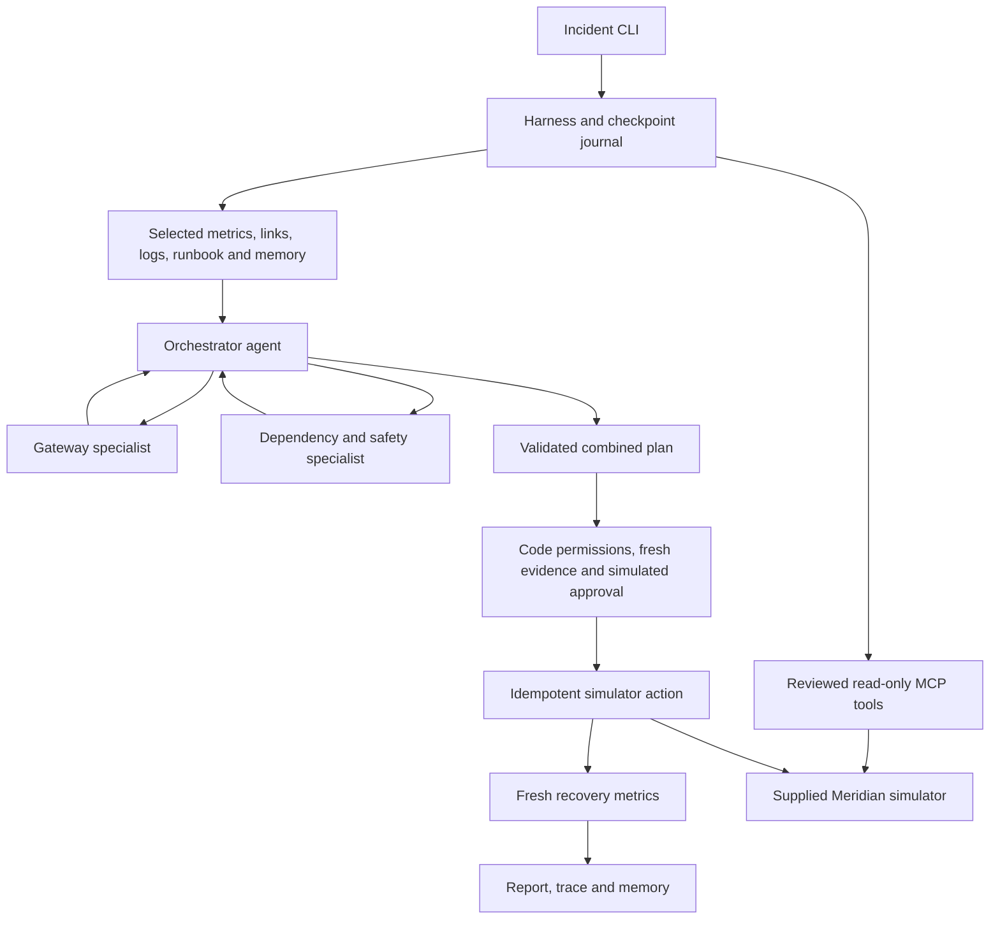

# Meridian Incident Response — final project starter

A portable boilerplate for the **Meridian Exchange** proposal in *Agentic AI: Da Arquitetura à Implementação*. Run everything from this folder. It includes a copy of the course simulator, so it has no imports or paths into the parent course repository.

**Start with [the project explanation](docs/PROJECT_BRIEF.md).** It translates the PDF into concrete behavior, deliverables and a requirement checklist. This starter is a working baseline to extend, not a claim that the final assessment is complete.

For the verbal Meridian introduction, see [lecture topics and suggested focus](docs/FOCUS_TOPICS.md). It maps the supplied sessions 1–7 to project features and reflects the trainer's clarification that the proposal diagram can be omitted.

## Quick start

Python **3.10 on Linux** matches the environment used to produce `requirements.lock`. The code declares Python >=3.10; other Python/OS combinations need their own resolved lock and validation.

```bash
cd meridian-incident-response
python3.10 -m venv .venv
source .venv/bin/activate
python -m pip install -r requirements.lock

# Offline fixture: real simulator + real in-process MCP, zero model requests.
python -m incident_response \
  --scenario cases/s03-alert-and-ticket.yaml --run-dir runs/demo
```

Expected: `status: recovered`, one restart of `order-gateway-2`, and post-action metric references. A fresh run needs a fresh `--run-dir`. Runtime files and SQLite memory live in ignored `runs/`.

For real agents, create a local `.env` from `.env.example` and fill in your API key:

```bash
cp .env.example .env
# Edit .env before running this command. Model requests use your API account.
python -m incident_response --mode llm \
  --scenario cases/s03-alert-and-ticket.yaml --run-dir runs/llm-demo
```

`OPENAI_MODEL` defaults to the model used in the course examples. Select a model available to your account. The three agents share a limit of 12 requests and 30,000 tokens per planning invocation. Failures produce a controlled report and retain the checkpoint. Live API behavior has not been validated by this starter's offline checks.

The CLI returns exit code 0 for recovered or intentionally paused runs, and 2 for refused, inconclusive or unrecovered runs. Those latter statuses can be the correct expected behavior for a failure case.

## What is wired up



The harness collects bounded evidence before delegation. The investigator diagnoses gateway pressure; the reviewer checks dependencies and the exact proposal. In LLM mode the orchestrator calls both specialists as tools, and code rejects a plan that changes or omits their results. Specialists have no mutation tools. The harness controls execution and verification.

The fixture mode follows a deterministic rule through the same contracts and executor. It is useful for setup and safety checks. It does **not** demonstrate LLM reasoning, autonomous tool selection or reliable resistance to prompt injection.

## Resume demonstration

```bash
python -m incident_response --scenario cases/s02-lost-response.yaml \
  --run-dir runs/resume-demo --pause-after action
python -m incident_response --run-dir runs/resume-demo --resume
```

The first action is applied but its response is lost by the simulator. The harness queries `action_status` with a stable key. Resume reconstructs the local simulated world from journaled tool intents, rechecks current permissions and the action's approval, then verifies recovery. There is one mitigation effect in the reconstructed world.

Try `--pause-after plan`, then resume with `--role settlement-analyst`: the new role must be refused. A resumed LLM run uses its saved model selection. A completed report is returned as recorded. Use one process per run directory.

This replay mechanism is specific to the deterministic, local simulator. It is **not** a production checkpoint backend for real infrastructure. [Architecture and policies](docs/ARCHITECTURE.md) explains the boundary.

## Evaluation

```bash
python -m pytest -q
python scripts/evaluate.py --output runs/fixture-baseline

# After configuring .env, measure the actual agents repeatedly:
python scripts/evaluate.py --mode llm --repeat 3 --output runs/llm-v1
```

Six seeded cases cover gateway pressure, unavailable metrics, a lost action response, multiple sources, refused approval and an injected log. Expected outcomes are held by the evaluator, outside model context. Evaluations use a fresh simulator and memory database per case. The evaluator checks expected status, the effect count and the action target; `checks/` also preserves four supplied course check files for extending evaluation with `meridian.evaluate`.

Tests additionally exercise interrupted resume, changed permissions, MCP description drift, memory correction/isolation/expiry and three-agent wiring with a scripted local model. Unit tests are included for these important boundaries, though the brief does not require writing a unit-test suite or metrics framework from scratch.

The initial local checks passed: **12 tests and 6 offline evaluation cases**. See [validation scope and results](docs/VALIDATION.md) and the representative artifacts in `evidence/fixture-baseline/`.

Checkpoint artifacts record inputs, selected context, plans, masked tool events, executor audit, approvals and final report. LLM runs also record messages and aggregate request/token usage. Review and copy selected, sanitized artifacts out of ignored `runs/` for submission. [Demo and evaluation guide](docs/DEMO.md) covers comparison and evidence.

## Where to work

| Path | Purpose |
|---|---|
| `incident_response/agents.py` | Three-agent wiring and deterministic baseline |
| `incident_response/contracts.py` | Validated specialist, plan, metrics and report contracts |
| `incident_response/workflow.py` | Context selection, evidence checks, orchestration, action and recovery |
| `incident_response/gateway.py` | MCP allowlist, description lock, scope refusals, journal and email masking |
| `incident_response/policy.py` | Permissions enforced outside the model |
| `incident_response/memory.py` | Team isolation, expiry, provenance and correction policy |
| `incident_response/state.py` | Atomic local checkpoint writes |
| `meridian/` | Supplied course infrastructure; see [source attribution](docs/ATTRIBUTION.md) |
| `cases/`, `checks/`, `tests/` | Inputs, separate course expectations and behavioral checks |
| `docs/ROADMAP.md` | Remaining work organized by the three milestones |
| `docs/PROPOSAL.md` | Filled-in starting proposal to review and adapt |

## Current scope and limits

- Implements the gateway memory-pressure mitigation only. Restart mitigates the symptom; it does not repair the memory leak. Rollback and other components need their own evidence guards, verification rules and cases.
- Context collection and two specialist responsibilities are deliberately fixed. Extend routing, follow-up investigation, source correlation and degraded-service handling as your own project work.
- Every mutation requires a simulated approval. `first-line` may restart only noncritical instances; approval cannot override its role. Whole-service restart tools are not exposed.
- Memory writes only verified incident summaries with provenance and seven-day validity. Recall filters team, confidence, superseded/future/expired records. Correction is an operator function; a full handover/deletion UI is not wired.
- MCP is functional in-process, with reviewed read-only tools and a description hash lock. Server metadata/schema pinning and remote transport are future extensions.
- Email masking is illustrative. Broader personal-data handling and adversarial LLM tests remain work to do.
- Checkpoints assume one local writer, trusted local files, the same simulator code and deterministic inputs. Replayed tool results must match. External-service persistence and distributed execution require a different adapter.

## Dependencies and moving to GitHub

`requirements.lock` pins the installed transitive dependency closure, including development tools, for the documented Python/Linux environment. `pyproject.toml` declares direct dependencies. To intentionally update dependencies, resolve/install the direct requirements in a fresh environment, validate it, then run `python scripts/lock_dependencies.py` there. The snapshot script checks installed compatibility; it is not a dependency resolver or a hash-verifying supply-chain lock.

The submission target is a **public GitHub repository** so evaluators can access the project. Copy or move **this entire folder**, including hidden files, to the destination. There is no nested `.git`, `.env`, virtual environment, or parent-relative import to carry along. After moving it outside the course Git repository:

```bash
git init
git add .
git commit -m "Start Meridian incident-response project"
# Create an empty PUBLIC repository on GitHub, then use its actual URL:
git remote add origin <your-github-repository-url>
git branch -M main
git push -u origin main
```

If copying it into an existing public repository, use that repository's existing Git setup. Preserve attribution for the supplied simulator. Before submission, verify that the repository and README are accessible while signed out of GitHub. Keep API keys in the ignored local `.env` file.

## AI assistance declaration

This starter was generated with OpenAI Codex assistance on 15 November 2026 after reviewing the local project brief and course exercises. Its simulator and four course cases/checks are copied from the supplied material. Record your subsequent AI use, architectural decisions, changes and validation here; be prepared to explain the code you submit.
