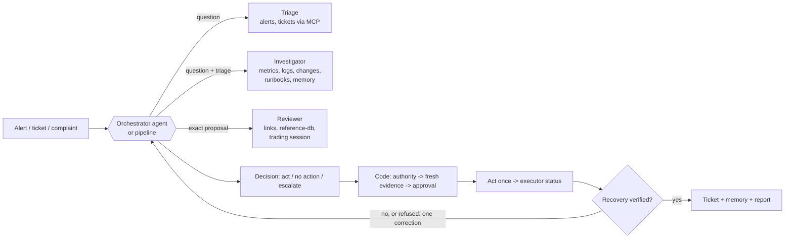

# Meridian Incident Response

An agent team that handles incidents on the **Meridian Exchange**, the fictional stock exchange simulated in the course
*Agentic AI: Da Arquitetura à Implementação* (Course 2 final project, common proposal).

An incident can arrive as an alert, a ticket or a member complaint. Three specialist agents work on it:
- **triage** groups the sources;
- the **investigator** finds the cause and proposes one runbook mitigation;
- the **reviewer** checks that proposal against the dependencies and the trading session.

An orchestrator agent, or a fixed pipeline, decides what happens next. **Code** then:
1. checks authority and re-reads fresh evidence;
2. obtains approval;
3. acts **once** with an idempotency key, and confirms the effect with the executor;
4. verifies recovery against the runbook, with one correction attempt if needed;
5. records the outcome on the incident ticket and in team memory.

Every step is checkpointed, so an interrupted run resumes without repeating an effect and without reusing an expired
approval.

| Document | Content |
|---|---|
| [docs/PROPOSAL.md](docs/PROPOSAL.md) | Problem, user, flow and diagram |
| [docs/ARCHITECTURE.md](docs/ARCHITECTURE.md) | Architecture, policies, decisions with their evidence, routing and fallback, monitors |
| [docs/EVALUATION.md](docs/EVALUATION.md) | Cases, expected and obtained results by version, comparisons, failures, limits |
| [docs/DEMO.md](docs/DEMO.md) | The 10-minute demo script |
| [docs/ATTRIBUTION.md](docs/ATTRIBUTION.md) | What comes from the course and what is project work |
| [evidence/](evidence/) | Results, comparisons and traces for each milestone |

## Setup

Requires Python 3.10 and [uv](https://docs.astral.sh/uv/). Tested on Linux. Dependencies are declared in
`pyproject.toml` and locked in `uv.lock`, which is the source of truth.

```bash
git clone https://github.com/Andre-Faria-9170113/Meridian-Exchange-agentic-incident-response.git
cd Meridian-Exchange-agentic-incident-response
uv sync --frozen --python 3.10 && . .venv/bin/activate
python -m pytest -q          # 51 behavioural tests, no network, about 30 s

# Without uv: requirements.lock is exported from uv.lock (same versions, with hashes)
#   python3.10 -m venv .venv && . .venv/bin/activate && pip install -r requirements.lock
```

For the model-backed mode, copy `.env.example` to `.env` and set `OPENAI_API_KEY`. Keys live only in `.env`, which
git ignores.
- `OPENAI_MODEL` defaults to `gpt-4.1-mini`.
- `OPENAI_FALLBACK_MODEL` is optional. It answers only when the primary model's API fails, and the same rules apply
  ([routing](docs/ARCHITECTURE.md#6-routing-and-fallback-session-9)).

## Running

```bash
# Offline: deterministic specialists, the real simulator and in-process MCP, no model calls
python -m incident_response run --scenario cases/s03-alert-and-ticket.yaml --run-dir runs/demo

# With the model: an orchestrator agent (default) or a fixed pipeline
python -m incident_response run --mode llm --scenario cases/s03-alert-and-ticket.yaml --run-dir runs/llm
python -m incident_response run --mode llm --coordination pipeline --scenario cases/s03-alert-and-ticket.yaml --run-dir runs/llm-p

# A person approves at the terminal instead of the scenario's simulated approver
python -m incident_response run --approver interactive --scenario cases/s03-alert-and-ticket.yaml --run-dir runs/approve
```

Expected for `s03-alert-and-ticket`:
- `status: recovered`;
- incident ticket MRX-2210, with MEM-1187 linked as related;
- one restart of `order-gateway-2`;
- "Recovery verified: order-gateway healthy in 3 consecutive readings".

Each run needs a new `--run-dir`. Everything a run writes stays in the ignored `runs/` folder:
- `checkpoint.json`: progress, the gateway journal, model messages, approvals, actions, usage and monitors;
- `report.json`;
- `world.pkl`: the simulated systems.

Interruptions and resume:

```bash
run ... --pause-after plan|action                          # stop at a phase boundary
run ... --crash-at approval|action|verify                  # die after the systems recorded the step (exit code 3)
python -m incident_response resume --run-dir <dir> [--downtime MIN] [--role <role>] [--approver interactive]
```

Memory, between runs. Only a person of the same team may correct or forget:

```bash
python -m incident_response memory --memory runs/memory.db list [--all]
python -m incident_response memory --memory runs/memory.db correct <ID> --text "..." --source "ticket MRX-2210"
python -m incident_response memory --memory runs/memory.db forget <ID> --reason "..."
```

Exit codes:

| Code | Meaning |
|---|---|
| 0 | Recovered, resolved or paused |
| 2 | Escalated, refused, not recovered or insufficient information. This is the correct outcome of several failure cases. |
| 3 | Crashed (`--crash-at`) |

## Evaluation

```bash
python scripts/evaluate.py --output runs/eval-fixture                                   # all 22 cases, no model
python scripts/evaluate.py --mode llm --repeat 3 --coordination pipeline --output runs/eval-llm   # about $0.75
python scripts/evaluate.py --compare evidence/milestone-3.2/pipeline runs/eval-llm
python scripts/review_catalog.py                                                       # MCP tools against the reviewed lock
```

The 20 public course cases and 2 project cases are scored with the course's own checks (`checks/*.yaml`). Every run
starts from the same initial state, except the ordered day-1/day-2 memory sequence. All runs use
`openai:gpt-4.1-mini` and 3 repetitions per case and coordination:

| Version | Fixture | LLM orchestrator | LLM pipeline |
|---|---|---|---|
| `baseline` (generated starter + evaluator) | 14/22 | — | — |
| `milestone-1` | 22/22 | — | — |
| `milestone-2` | 22/22 | 59/66 | 60/66 |
| `milestone-3` | 22/22 | 60/66 | 62/66 |
| `milestone-3.1` | 22/22 | 59/66 | 63/66 |
| `milestone-3.2` (final evaluation) | 22/22 | 58/66 | **63/66** |

- 0 critical monitor alerts in 528 real-model runs: no unapproved or repeated effect, and no unverified recovery
  claim.
- Every failure escalates or stops safely, and most come from three cases where the model's judgment or the 40k token
  budget decides.
- The fixture's 22/22 shows that the plumbing works. Its rules were written knowing the public cases, so **it is not an
  agent result**.

Details are in [docs/EVALUATION.md](docs/EVALUATION.md).

## Architecture in brief



**Agents and code:**
- Specialists only read, through one gateway, and every output passes validators before the next step uses it.
- The gateway handles:
  - per-caller allowlists;
  - MCP tools pinned to a reviewed catalog lock;
  - a write-ahead journal;
  - personal-data masking;
  - evidence refs.
- Read budgets and request and token limits are enforced in code.

**Policies, all enforced in code:**
- `first-line` may act only on non-critical components; critical targets are refused and escalated.
- Every action needs an approval for exactly that action and target. The approval is valid for 15 minutes, and not
  across the trading-session opening.
- A restart needs fresh readings showing that instance above 90% memory. A rollback needs a log line naming the
  change.
- Recovery means three consecutive healthy readings after the action, by that action's runbook.
- Memory is written by code, only after a verified recovery. It is isolated per team and has a validity period.

The full picture, with the decisions and their evidence, is in [docs/ARCHITECTURE.md](docs/ARCHITECTURE.md).

## Limits

- **One model, three repetitions.** Totals moved within 58–63 of 66 across four evaluations. Differences of one or
  two runs per case are within that variance.
- **Known failing cases:**
  - s02-firewall-change: the model often proposes no rollback;
  - s04-conflicting-shift-notes: CHG-4471 often goes unnamed;
  - s02-hidden-config-change: often over the 40k token budget.

  All three end in a safe escalation. Prompts were not tuned for these public cases.
- Two mitigations (restart one instance, roll back one change), one action per incident, at most one correction.
- The fallback model is tested with a scripted outage only. Crash and resume are tested in code and in the demo, not
  in the repeated evaluations.
- The simulator, executor, approvals and tickets are local and synthetic.

## Versions

| Tag | Content |
|---|---|
| `v0-starter` | Generated starter, unchanged |
| `baseline` | Starter plus the evaluator with the course checks; baseline results |
| `milestone-1` | First-line incident agent: specialists with tools and MCP, correlation, guarded actions, verification (sessions 1–3) |
| `milestone-2` | Production on-call agent: memory operations, interactive approval, validators, repeated evaluation (sessions 4–6) |
| `milestone-3` | 24/7 incident response centre: correction loop, crash and resume, approval validity, monitors, routing and fallback (sessions 7–9) |
| `milestone-3.1` | Corrections from the earlier finding, no circling; evaluation |
| `milestone-3.2` | Fixes found in the 3.1 traces; final evaluation |

## AI assistance

- The starter (`v0-starter`) was generated with OpenAI Codex on 15 November 2026.
- From 24 November 2026, Claude Code (Claude Opus 5.5) worked at the student's direction. It reviewed the starter
  against the brief and the course material, and wrote:
  - the evaluator;
  - the agent layer and the code of all three milestones;
  - the tests;
  - the evidence READMEs and these documents.

  It also ran the evaluations. The student set the plan and decided between the options proposed. The student also
  approved every real-model run (API cost) and every milestone, and pushed the repository.
- The working plan and notes are in [CLAUDE.md](CLAUDE.md).
- The course material (simulator, cases, checks, MCP servers) is by Luís Noronha. See
  [docs/ATTRIBUTION.md](docs/ATTRIBUTION.md).
