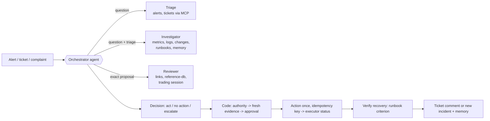

# Meridian Incident Response

An agent team that handles incidents on the **Meridian Exchange**, the fictional stock exchange simulated in the course
*Agentic AI: Da Arquitetura à Implementação* (Course 2 final project, common proposal).

Given an alert, a ticket or a member complaint, three specialist agents correlate the sources, investigate and propose a
runbook mitigation. An orchestrator decides what happens next. Code then checks authority, re-reads fresh evidence,
obtains approval, acts **once** with an idempotency key, confirms the effect with the executor, verifies recovery
against the runbook criterion and records the outcome on the incident ticket and in memory.

> **Status: milestone 1** (first-line incident agent). Milestones 2 and 3 are in progress. Apart from this README and
> `docs/ATTRIBUTION.md`, the files in `docs/` still describe the generated starter (`v0-starter`) and are being rewritten.

## Quick start

Dependencies are declared in `pyproject.toml` and locked in `uv.lock`, the single source of truth. Tested on Python
3.10 on Linux.

```bash
uv sync --frozen --python 3.10 && source .venv/bin/activate

# Without uv: requirements.lock is exported from uv.lock (same versions, with hashes)
#   python3.10 -m venv .venv && source .venv/bin/activate && pip install -r requirements.lock

# Offline: deterministic specialists, real simulator, real in-process MCP, no model calls.
python -m incident_response run --scenario cases/s03-alert-and-ticket.yaml --run-dir runs/demo
```

Expected: `status: recovered`, MRX-2210 as the incident ticket with MEM-1187 related, one restart of
`order-gateway-2` and verification references. Each run needs a new `--run-dir`. Everything a run writes stays in the
ignored `runs/` folder.

With models (each run makes several requests on your API account):

```bash
cp .env.example .env        # then set OPENAI_API_KEY
python -m incident_response run --mode llm --scenario cases/s03-alert-and-ticket.yaml --run-dir runs/llm-demo
python -m incident_response run --mode llm --coordination pipeline --scenario ... --run-dir ...
```

Pause and resume in another process. The simulated systems are saved apart from the agent's checkpoint, and authority
is checked again on resume:

```bash
python -m incident_response run --scenario cases/s02-lost-response.yaml --run-dir runs/resume --pause-after action
python -m incident_response resume --run-dir runs/resume
python -m incident_response run --scenario cases/s03-alert-and-ticket.yaml --run-dir runs/role --pause-after plan
python -m incident_response resume --run-dir runs/role --role settlement-analyst     # refused, no effect
```

Exit code 0 means recovered, resolved or paused. Exit code 2 means escalated, refused, not recovered or insufficient
information, which is the correct outcome for several failure cases.

## How it works



| Part | Responsibility |
|---|---|
| `incident_response/agents.py` | The three LLM specialists, each with its own read-only toolset and validated output, plus two coordinators: an **orchestrator** agent whose tools are the specialists, and a fixed **pipeline**. Output validators reject evidence refs no tool returned and ticket keys triage never saw. |
| `incident_response/rules.py` | Deterministic specialists with the same contracts and permissions (`--mode fixture`): offline runs, tests, reference baseline. |
| `incident_response/gateway.py` | The only path to the systems. Per-caller allowlists (specialists read; only code mutates), reviewed MCP tools pinned by description and schema hash, unreviewed servers never connected, list sizes clamped, write-ahead journal, one retry on retryable errors, scope refusals remembered, personal data masked, evidence refs (`T01`...). |
| `incident_response/policy.py` | Authority in code: role and target, approver role, matching approval. An approval never grants a role. |
| `incident_response/guards.py` | Runbook criteria in code: fresh evidence before acting, recovery verification after. |
| `incident_response/workflow.py` | Phases, checkpoint, action/verification, ticket update, report. |
| `incident_response/world.py` | The simulated systems, persisted after every call (`world.pkl`) apart from the agent's checkpoint. |
| `incident_response/memory.py` | Memory policy: code-built summaries of verified recoveries only, team isolation, confidence, validity, correction, deletion. |
| `meridian/` | Course simulator, tools and MCP servers, copied unchanged (see [attribution](docs/ATTRIBUTION.md)). |

Main policies:
- Specialists cannot change anything. Mutations (approval requests, restart, rollback, ticket writes) are harness code only.
- `first-line` may act only on non-critical components. A critical target (matching-engine, reference-db) is refused
  and escalated. Every action needs a matching approval, from the incident manager for critical targets during the
  trading session.
- A restart needs fresh readings showing that instance above 90% memory, with the dependency links up and reference-db
  healthy. A rollback needs an active change that a log line names. Timing alone is reported as a suspected cause and
  escalated.
- "Recovered" means three consecutive healthy readings after the action. "Resolved" means healthy now, with no action
  needed.

## Evaluation

```bash
python -m pytest -q                                          # 26 behavioural tests, no network
python scripts/evaluate.py --output runs/eval-fixture        # all cases, course checks
python scripts/evaluate.py --mode llm --repeat 3 --output runs/eval-llm
python scripts/evaluate.py --compare evidence/v0-starter runs/eval-fixture
```

`cases/` holds the 20 public course cases (sessions 1–4) and two project cases. Each case is scored with its
`checks/<id>.yaml` by the course's own `meridian.evaluate`. The checks cover the report claim, required reads,
forbidden and maximum effects, ticket updates, memory contents, personal data sent to the model, token budget and
recovery held for several ticks. Every case starts from a fresh simulator and memory, except the ordered day-1/day-2
memory sequence.

| Version | Mode | Cases passing every check |
|---|---|---|
| `baseline` (starter + evaluator) | fixture | 14/22 ([results](evidence/v0-starter/results.md)) |
| `milestone-1` | fixture | 22/22 ([results](evidence/milestone-1/results.md), [comparison](evidence/milestone-1/comparison.md)) |

The fixture specialists are deterministic rules written with knowledge of these public cases. The fixture results show
that the harness, guards, MCP and evaluation plumbing work. **They are not a measure of the LLM agents.** Repeated LLM
runs on the same cases are the next step.

## Current limits

- The LLM mode is tested with a scripted local model only and has not yet been run against a real model.
- Two action types (`restart_instance`, `rollback_change`), one action per incident. There is no correction attempt
  after a refusal or a failed recovery yet.
- Resume supports pause points. Crash injection, time passing during the interruption and approval expiry are milestone 3.
- Approvals are simulated by the scenario's approver policy.
- If a selected ticket or alert tool's description changes, triage fails closed (`insufficient_information`) rather
  than risk duplicate incident tickets.

## Versions

| Tag | Content |
|---|---|
| `v0-starter` | Generated starter, unchanged |
| `baseline` | Starter + evaluator with the course checks; baseline results |
| `milestone-1` | First-line incident agent: specialists with tools/MCP, correlation, guarded actions, verification |

## AI assistance

- The starter (`v0-starter`) was generated with OpenAI Codex on 15 November 2026.
- On 24 November 2026, Claude Code (Claude Opus 5.5) reviewed it against the brief and the course material. It also
  wrote the evaluator, the agent-layer rewrite for milestone 1, the tests and this README, at the student's direction.
- The working plan is in `CLAUDE.md`.
