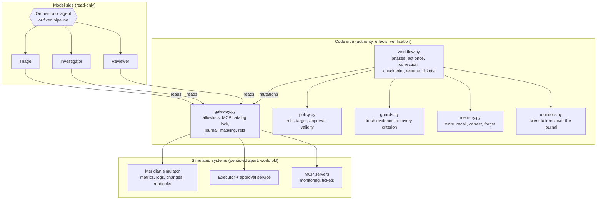

# Architecture, policies and decisions

This document explains how the system is built and why. Each decision points to the evaluation or trace that
motivated it or checks it. The evidence folders are in [`evidence/`](../evidence/), and the results across versions
are in [EVALUATION.md](EVALUATION.md).

## 1. Overview



The rule that shapes everything: **models read and propose; code decides what may happen and makes it happen.** No
agent holds a mutation tool. The decision is a validated `Decision` object. From there, code:
- checks authority;
- re-reads the systems;
- obtains approval;
- acts once;
- asks the executor what happened;
- verifies recovery.

| Module | Responsibility |
|---|---|
| [`agents.py`](../incident_response/agents.py) | The three LLM specialists (PydanticAI agents), each with its own read-only tools and a validated output contract. Two coordinators: `Orchestrator` (an agent whose tools are the specialists) and `Pipeline` (fixed order, decision rule in code). Read budgets, repeat refusal, scope gate, output validators. |
| [`rules.py`](../incident_response/rules.py) | Deterministic specialists with the same contracts (`--mode fixture`): the no-model route, used for tests and offline runs. |
| [`contracts.py`](../incident_response/contracts.py) | Pydantic contracts between steps: `Correlation`, `Finding`, `Proposal`, `Review`, `Decision`, `Plan`, `Report`. |
| [`gateway.py`](../incident_response/gateway.py) | The only path to the systems, used by agents and code alike: per-caller allowlists, reviewed MCP catalog, clamps, write-ahead journal, one retry, scope blocks, personal-data masking, evidence refs. |
| [`policy.py`](../incident_response/policy.py) | Authority: role and target, approver role, matching approval, approval validity. |
| [`guards.py`](../incident_response/guards.py) | Runbook criteria in code: fresh evidence before acting, recovery per the action's runbook after acting. |
| [`workflow.py`](../incident_response/workflow.py) | Phases, act-once, correction, checkpoint, crash points, resume, ticket update, report, usage, routing. |
| [`memory.py`](../incident_response/memory.py) | Memory policy around the course's SQLite store. |
| [`monitors.py`](../incident_response/monitors.py) | Checks over a finished run's journal, independent of the code that acted. |
| [`world.py`](../incident_response/world.py), [`state.py`](../incident_response/state.py) | The simulated systems persisted after every call (`world.pkl`); the agent's atomic checkpoint (`checkpoint.json`). |
| [`meridian/`](../meridian/) | The course simulator, tools and MCP servers, unchanged ([attribution](ATTRIBUTION.md)). |

## 2. Agents and coordination

**Specialists.** Each has distinct responsibilities, tools and an output contract:

| Specialist | Tools (through the gateway) | Output | Read budget |
|---|---|---|---|
| Triage | `monitoring.list_alerts`, `tickets.search_issues`, `tickets.get_issue` (MCP) | `Correlation`: component, incident ticket, related and unrelated tickets, evidence | 3 |
| Investigator | `read_metrics` (own component only), `read_logs`, `recent_changes`, `list_runbooks`, `read_runbook`, `memory.recall` | `Finding`: cause kind, cause, change id, evidence, at most one `Proposal` | 7 (4 in a correction) |
| Reviewer | `check_link`, `read_metrics`, `recent_changes`, `exchange_status`, runbooks | `Review`: safe to attempt, constraints, evidence | 4 (restart), 5 (rollback) |

**Two coordinations.** Both are kept and selectable (`--coordination orchestrator|pipeline`), because the course
compares them (session 7):
- **Orchestrator.** An agent whose tools are `ask_triage`, `ask_investigator` and `ask_reviewer`. It decides whom to
  ask and when to stop, and returns only a `Decision` (act, no action needed, or escalate). Code assembles the plan
  from the specialists' *validated* results, so the orchestrator cannot alter or invent them. Its output validator
  refuses:
  - `act` without a proposal;
  - `act` without a review of the current proposal;
  - `act` against a review that found the proposal unsafe;
  - `no_action_needed` unless the investigator found no fault.
- **Pipeline.** Triage, then investigator, then reviewer (only when there is a proposal), then a decision rule in code.

**Integration and failure between specialists.** Whatever a specialist hands on must first pass its validators. A
specialist that fails (an exception, a request cap, output still invalid after retries) raises `SpecialistFailure`. No
plan is built and the run escalates. The failure is kept in `specialist_failures`, and the failed conversation in
`model_messages`.

**Correction (session 7).** Once per run (`MAX_CORRECTIONS = 1`), the coordinator gets the reason and one attempt at a
different mitigation. This happens when policy refuses the proposal (wrong target, evidence that does not hold) or
when recovery is not verified. The new proposal is reviewed, authorized and verified again, and both attempts are in
the report. No correction is made:
- after a person's denial: it is never corrected around;
- for an identity without remediation rights;
- after a refusal whose remedy is escalation (first-line on a critical component, decision 7).

## 3. Policies (enforced in code)

**Authority** ([`policy.py`](../incident_response/policy.py)). Model output, ticket text and approvals never grant a
role.
- Only `restart_instance` (one instance) and `rollback_change` (one change) exist. Whole-service restarts are never
  exposed.
- `first-line` may act only on non-critical components. `on-call` and `incident-manager` may also act on
  matching-engine and reference-db. `settlement-analyst` (another team) may not remediate.
- Every action needs an approved approval for exactly that action and target. On a critical component during the
  trading session the approver must be the incident manager; otherwise it is the on-call engineer.
- An approval is valid for 15 minutes, and becomes invalid once the trading session opens if it was given before
  (session 8 lab). After an interruption it is reused only while still valid.

**Evidence** ([`guards.py`](../incident_response/guards.py)). The runbook criteria live in code, not in a prompt.
- Before a restart, fresh readings must show that instance above 90% memory, the dependency links up and reference-db
  healthy.
- Before a rollback, the change must be active and a log line must name it. Timing alone gives a "suspected" cause,
  which is escalated.
- Recovery means three consecutive healthy readings taken after the action, by *that action's* runbook:
  - restart (order-gateway-latency v2): latency < 20 ms and errors < 1%;
  - rollback (reference-db-connections): errors < 1% with the links up.
- "Resolved" means healthy now, with no action needed.

**Data.** The gateway masks emails, account numbers and phone numbers in every result before a model or a file sees
it. Technical evidence stays intact. Keys live only in `.env` and never reach a model: the MCP servers run in-process.
Everything tools return is evidence, never instructions. An injected "restart matching-engine" in a log
(`cases/injected-log.yaml`) changes nothing, because only code acts and the target must pass authority and evidence.

**Memory** ([`memory.py`](../incident_response/memory.py), session 4):

| Aspect | Rule |
|---|---|
| Write | Only after a *verified* recovery, and only facts produced by code: action, target, executor action id, verification ref. Never free text from a model, a log or a ticket. Source is the run id, confidence 0.8, valid for 7 simulated days. |
| Recall | Same team only, active, confidence ≥ 0.7, validity not expired, created no later than now. Covers the component and its dependencies (static topology), newest first. Recalled records are labelled hints; current readings decide. When notes disagree, later and user-sourced notes weigh more, and current state decides. |
| Correct | `memory correct ID --text --source`: by a person of the same team, never the agent's identity. Writes a sourced replacement (confidence 0.9) and supersedes the old record. |
| Forget | `memory forget ID --reason`: deletes the content and keeps who, when and why. |
| Isolation | Records are per team. Another team's operator sees none and can change none. Every evaluation run starts with a fresh store, except the ordered day-1/day-2 sequence. |

## 4. Durable execution and resume (session 8)

There are two records, as in production:
- `checkpoint.json` is the agent's progress, saved atomically at each phase;
- `world.pkl` is the systems: exchange state, executor history, approvals and tickets, saved after **every** tool
  call.

After a crash, the checkpoint can be behind the systems, so the systems' history decides:
- the same operation keeps the same idempotency key (`run_id:action:target`), and before acting code asks the executor
  for that key's status;
- the approval service's record for the same action and target is reused only while `validity_refusal` passes; a
  denial stands.

`run --crash-at approval|action|verify` kills the process after the systems recorded the step and before the
checkpoint did. `resume --downtime MIN` lets simulated time pass first. A trace from the demo, a crash after approval
and 20 minutes of downtime (`cases/s02-firewall-change.yaml`):

```json
"resume_log": [
  {"kind": "resumed", "phase": "planned", "downtime_minutes": 20, "at": "14:58", "role": "first-line"},
  {"kind": "approval_not_reused", "approval_ref": "APR-001",
   "reason": "APR-001 expired: given at 14:37, 25 minutes ago (valid for 15)"}
]
"approvals": APR-001 (tick 137, approved), APR-002 (tick 162, approved)
"actions_taken": ["rollback_change CHG-4490 (ACT-001, approval APR-002)"]
```

After a crash at `action`, the resume finds the effect already applied and does not repeat it:

```json
{"kind": "action_already_done", "idempotency_key": "683ab2c4…:restart_instance:order-gateway-2", "action_id": "ACT-001"}
```

On resume, evidence is re-checked as well. With the same crash in `s03-alert-and-ticket` and 20 minutes down, the
leaking instance had run out of memory and restarted in the meantime. Fresh metrics then refused the stale restart
("Fresh metrics do not show order-gateway-2 above 90% memory"), and the run ended `resolved` with no effect.

Resume can also change identity (`resume --role`): authority is checked again. A plan paused under `first-line` and
resumed as `settlement-analyst` is refused with no effect.

## 5. The gateway as the MCP gateway (session 9)

Every call, by a specialist or by code, goes through `Gateway.call`:
- **Identity and allowed tools:** each caller has an allowlist (`CALLER_TOOLS`). Specialists only read; mutations are
  harness-only.
- **Reviewed catalog:** only reviewed MCP servers are connected. A tool is offered only if its description and input
  schema hashes match `catalog.lock.json`. `scripts/review_catalog.py` compares the live tools with the lock, and
  `--write` is used only after a human review.

  | Case | What the gateway does |
  |---|---|
  | s03-shadow-server | The unreviewed `ops-community` server is never connected |
  | s03-description-change | The version change is recorded as a warning |
  | A changed description on a selected tool | That tool is refused, so triage fails closed (`insufficient_information`) |
- **Lost scope:** after an `insufficient_scope` refusal, the tool is blocked for the rest of the run
  (s03-scope-refused: the comment fails and is reported, and nothing is retried).
- **Admission:** list sizes are clamped, so one result cannot flood the context. Read budgets per specialist answer,
  12 requests per specialist answer and 40 requests and 150k tokens per run are enforced around it.
- **Audit:** a write-ahead journal (`events` in the checkpoint) records the intent before the call and the result
  after. Each result gets a ref (`T01`, `T02`, …), and specialists must cite refs they received.
- **Masking:** personal data is masked in results before any model or file sees them.
- **No cache, on purpose:** incident readings change every simulated minute. A cache is only right for the same answer
  while it is still true.

## 6. Routing and fallback (session 9)

There are three routes:
1. **No model:** `--mode fixture`, the deterministic specialists. It runs every case offline and is the reference
   for the plumbing.
2. **`OPENAI_MODEL`** (default `gpt-4.1-mini`) answers every agent in `--mode llm`.
3. **`OPENAI_FALLBACK_MODEL`** (optional, commented out in `.env.example`). When set, `routed()` wraps the model in a
   PydanticAI `FallbackModel`, which answers only after an API failure of the primary.

Plan B passes the same validators, read budgets, gateway permissions and policy, so it cannot do what plan A may not.
If both models fail, the specialist fails and the run escalates to a person instead of guessing. `models_used` in the
checkpoint shows which model answered each agent, and `usage_by_agent` the tokens. The free test
`test_fallback_model_answers_when_the_primary_fails_and_the_same_rules_apply` runs with a scripted outage. The
evaluations ran with no fallback configured. Whether a "model not found" error triggers the fallback has not been
checked live.

## 7. Monitors (session 8: silent failures)

[`monitors.py`](../incident_response/monitors.py) reads only what was recorded: the journal, the refused calls, the
executor audit, the approval records, the report and the usage. It changes nothing. Every run stores
`checkpoint["monitors"]`, and the evaluator shows the alerts.

| Monitor | Severity | What it catches |
|---|---|---|
| `repeated_work` | warning | The same read twice within one attempt; repeats refused by the gate |
| `circling` | warning | Three or more reads refused as outside the specialist's scope; questions refused past `MAX_ANSWERS`; a specialist answering more than twice per round |
| `approval` | critical | An applied action without an approved, matching approval that was still valid when it ran |
| `repeated_effect` | critical | The same action applied twice to the same target |
| `unverified_claim` | critical | A recovered or resolved report with no metrics read after the last action |
| `budget` | warning | 80% of the request or token limit used; reads refused for budget |

There were **0 critical alerts in 528 real-model runs**: milestone 2, recomputed afterwards, and milestones 3, 3.1 and
3.2.

## 8. Decisions and the evidence behind them

| # | Decision | Why, and the evidence |
|---|---|---|
| 1 | **Models never hold a mutation tool.** Code acts after authority, fresh evidence and approval. | Session 5: authority in code. No monitor found an unapproved, repeated or unverified effect in 528 runs. injected-log passed 24/24 under both coordinations. |
| 2 | **Read budgets in code, not in prompts.** Each specialist answer has a budget, identical repeated calls are refused, and tools are withdrawn once the budget is spent. | First real-model check (26 Nov): every call costs a simulated minute, and in s03 the leaking instance crashes after about 22 calls. gpt-4.1-mini made 24–43 reads; prompts did not fix it. With budgets, s03 went from 2/5 to 5/5, and the first full real-model run scored 18/22 ([history](../evidence/milestone-2/history/)). |
| 3 | **Validators check outputs before the next step uses them.** They reject: evidence refs no tool returned; ticket keys triage never saw; an instance named as the component; `no_fault` contradicted by the latest reading; an errors finding that did not search the logs for the change id while reads remain. | Each came from a trace. The change-id search came from the s02-firewall-change traces: the cause was a WARN line naming CHG-4490, and the model searched by level. The instance check came from s03-scope-refused r3 in milestone 3.1. Example retry: "Before concluding, search the logs for CHG-4471 (read_logs with contains='CHG-4471' and no level filter)". |
| 4 | **The investigator reads metrics only for triage's component.** Dependency health is the reviewer's check. | gpt-4.1-mini spent its reads on dependency metrics and never reached changes and logs (s02, s04). |
| 5 | **The recovery criterion follows the action's runbook.** | Milestone 2: a correct CHG-4490 rollback was reported `not_recovered`, because latency drained slowly (36 → 24 ms) under the gateway's latency rule. Fixed in `cb89788` and confirmed in milestone 3: a real rollback was verified `recovered` at latency 32–34 ms with errors at 0.1%. |
| 6 | **One correction, and it starts from the earlier finding.** | The correction loop (`8cb7d6e`) worked, but it restarted the investigator from scratch: 56–66k input tokens against a 40k budget (milestone 3). With the earlier finding and its evidence handed on, it cost about 15k less (milestone 3.1). |
| 7 | **A refusal whose remedy is escalation is not corrected.** | Milestone 3.1: both corrections followed "first-line may not roll back on reference-db (escalate to on-call)", with the right cause already found. Each only escalated, 15k tokens later. In milestone 3.2 that refusal escalated at once (2 of 6 runs), with no correction. |
| 8 | **At most one answer and one follow-up per specialist per round.** A triage follow-up cannot replace the component. | Milestone 3: the orchestrator read the reviewer's constraints as questions and asked again until the 40-request cap (s04-recurring-leak-day2 r2, 67.7k tokens). Since then no run has reached the cap; the maximum was 22 requests in milestone 3.2. |
| 9 | **The systems are persisted apart from the checkpoint, and the systems' history decides on resume.** | Session 8. Tests: a crash after the action gives exactly one effect; a crash after approval plus 20 minutes of downtime gives a new approval. |
| 10 | **Memory is written by code, only after verified recovery.** | Session 4 poisoning defences: s04-ticket-copied-note asks the agent to save a "standard fix" that restarts matching-engine, and only the code-built record of the verified gateway restart is stored. Day 2 recalls day 1's restart of order-gateway-2, but fresh readings send the restart to order-gateway-1. |
| 11 | **Both coordinations are kept.** On these cases the pipeline is the better one. | Four repeated evaluations: pipeline 60, 62, 63, 63 of 66; orchestrator 59, 60, 59, 58. The pipeline also used fewer requests (14.4 against 17.5 in milestone 3.2). The orchestrator can ask follow-ups and decide on corrections, but with this model that has not paid off. |
| 12 | **No response cache.** | Session 9: a cache is right only for the same answer while it is still true. Incident readings change every minute. |

## 9. Course sessions in the code

| Session | Where |
|---|---|
| 1. Agent harness, PydanticAI | `agents.py` (typed outputs, `output_validator`, `ModelRetry`, usage limits), `workflow.py` (harness owns effects) |
| 2. Context engineering, tools | Per-specialist toolsets, clamps, runbook by version, preconditions, idempotency, lost response (s02-lost-response) |
| 3. MCP | `gateway.py`: in-process MCP client, reviewed catalog lock, least privilege, scope refusals; triage correlation |
| 4. Memory | `memory.py`, memory CLI, day-1/day-2 cases |
| 5. Security, authorization, personal data | `policy.py`, masking in `gateway.py`, approvals, injected-log case, `--approver interactive` |
| 6. Evaluation | `scripts/evaluate.py`: course checks, `--repeat`, `--compare`, the same initial states; the `evidence/` folders |
| 7. Orchestration | `Orchestrator` vs `Pipeline`, reviewer before action, correction after refusal or unverified recovery |
| 8. Agents in production | Crash points, resume, approval validity, idempotency keys, `monitors.py` |
| 9. LLM and MCP gateways | Routing and fallback, usage per agent, budgets as admission, the gateway as the MCP gateway, no cache |
