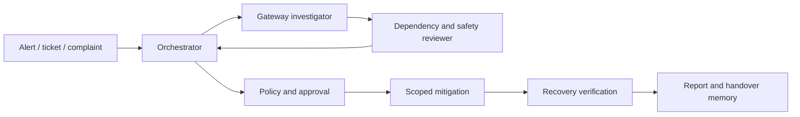

# Proposal: Meridian Incident Response

These are optional planning notes. Per the trainer clarification reported by the student, the Meridian introduction can be a verbal explanation of the intended lecture-feature focus; the proposal diagram below is not required. See [FOCUS_TOPICS.md](FOCUS_TOPICS.md) for topics and an example verbal introduction.

**Problem.** Meridian operators receive monitoring alerts, internal incidents and member complaints describing degraded exchange services. Manual triage repeats work, and an incorrect restart or rollback can disrupt critical components.

**User.** The operations/on-call engineer responsible for diagnosing incidents, authorizing mitigations and communicating evidence of recovery.

**Main flow.** Receive the incident; gather bounded monitoring, ticket, runbook and memory context; delegate diagnosis and dependency review; integrate validated findings; check permissions and current evidence; obtain approval; execute a scoped idempotent action; observe recovery; record the result and a qualified memory.

**Initial scope.** The provided starter mitigates a single unhealthy order-gateway instance. The final scope should add justified source correlation and at least one additional incident/remediation family, with evaluations matching the brief. That additional-family suggestion is an engineering recommendation, not a separately stated numerical minimum in the PDF.

**Boundaries.** Synthetic local exchange only. No real trading, production infrastructure or external ticket writes. A CLI is sufficient. Critical targets remain behind code permissions and approval. Missing evidence causes escalation rather than an unsupported recovery claim.

**Success evidence.** A multi-source incident recovered with fresh metrics; a forbidden/refused action with zero effects; a lost action response reconciled; work resumed after interruption with no duplicated mitigation; relevant memory recalled and stale/cross-team memory excluded; version comparisons over fixed seeded cases.

**Architecture decisions to validate.** Use two focused read-only specialists, a typed orchestration boundary, deterministic mutation guards and a separate verification stage. Start with preselected context to keep costs and failure modes inspectable. Extend investigation routing only where evaluation shows it helps.
