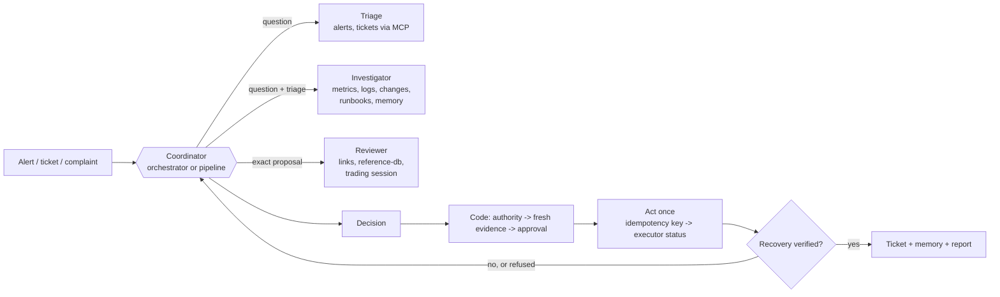

# Proposal: Meridian Incident Response

Course 2 final project, *Agentic AI: Da Arquitetura à Implementação*, common proposal (Meridian Exchange).

## Problem

The Meridian Exchange's operators receive the same incident from several directions: a monitoring alert, an internal
incident ticket, a member complaint. Each source shows part of the picture. Triage repeats work across shifts, and the
obvious fix is not always the right one. Restarting a gateway instance does not help when a database limit was lowered
on another component, and restarting the wrong instance disturbs trading. Some actions touch critical components
(matching-engine, reference-db), which first-line staff may not change during the trading session.

## User

The **first-line operations engineer** on shift, who must:
- understand an incident quickly;
- apply a runbook mitigation when it is safe;
- prove recovery;
- otherwise hand over to on-call with the evidence gathered.

The on-call engineer and the incident manager are the approvers. They are also the escalation targets for critical
components.

## Main flow

1. **Receive** the incident (alert id, summary, time) and select the context: active alerts, open tickets, metrics,
   logs, recent changes, the applicable runbook and team memory.
2. **Triage** names the affected component and groups the tickets and complaints about the same problem. Similar words
   on another component are not enough.
3. **Investigate:** find the cause from metrics, logs and changes. Propose at most one runbook mitigation, citing the
   evidence.
4. **Review:** an independent specialist checks the dependencies, reference-db and the trading session for that exact
   proposal.
5. **Decide:** act, no action needed, or escalate. An orchestrator agent decides, or a fixed pipeline in code.
6. **Authorize in code:**
   - the role may act on the target;
   - fresh readings still justify the action;
   - a person (or the scenario's approver) approves that exact action and target.
7. **Act once**, with an idempotency key, then confirm the effect with the executor.
8. **Verify recovery** against the runbook's criterion. If the action is refused or recovery is not verified, make one
   correction attempt, then review again.
9. **Record:**
   - comment on the incident ticket (or open one) and link the related tickets;
   - write a code-built memory of the verified recovery for the next shift;
   - produce a report with the cited evidence.

Every step is checkpointed. An interrupted run resumes from the systems' history, without repeating an effect and
without reusing an approval that is no longer valid.

## Scope and boundaries

- Synthetic exchange only: the course's Meridian simulator, tools and MCP servers, run locally. No real trading,
  infrastructure or external ticket system.
- Two mitigations: restart one gateway instance, or roll back one change. Whole-service restarts are never exposed.
- A command-line interface. The person approves at the terminal (`--approver interactive`), or the scenario's
  simulated approver answers.
- Model keys live only in `.env`. The offline mode (`--mode fixture`) runs every case with no model.

## How success is shown

The 20 public course cases and two project cases, each with the course's own checks, run three times per
coordination at each milestone. Every evaluation starts from the same cases and the same initial state. The cases
cover:
- a multi-source incident recovered and verified;
- missing metrics and a failing service, both ending in a controlled stop;
- a refused action with zero effects;
- an injected instruction in a log;
- a lost action response, a crash and resume with exactly one effect;
- memory across two shifts;
- tool catalog changes and lost permissions.

See [EVALUATION.md](EVALUATION.md) for the results.
